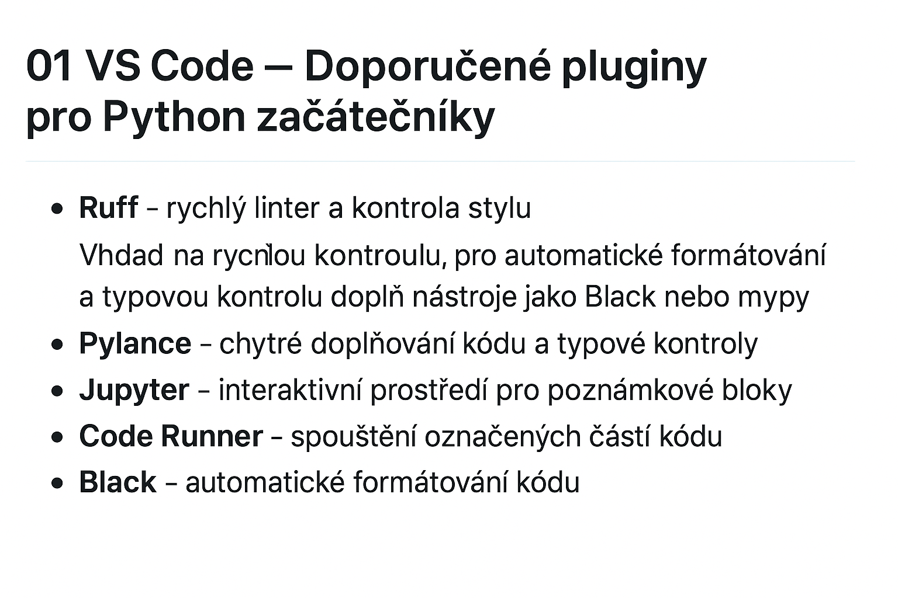

# 01 VS Code – Doporučené pluginy pro Python začátečníky

V této lekci se naučíš, jaké rozšíření (pluginy) potřebuješ ve VS Code, aby se ti v Pythonu pracovalo pohodlně a přehledně.

---

## 1. Ruff 
– rychlý linter a kontrola stylu
**Funkce:**  
Ruff je extrémně rychlý nástroj, který kontroluje kód z hlediska **chyb, stylu a potenciálních problémů**.  
V podstatě kombinuje funkce starších linterů (pylint, flake8, pyflakes) a navyšuje produktivitu tím, že běží bleskově i na velkých projektech.

---

### 🔹 Jak funguje

Ruff analyzuje Python kód a upozorňuje na:
- chyby syntaxe nebo runtime problémy (už při psaní)
- nesprávný styl podle PEP8
- zbytečné mezery, nepoužívané importy a proměnné
- potenciální logické chyby
```
python
  import os, sys

def pozdrav(jmeno):
  print("Ahoj "+Jmeno)

pozdrav("Filip")
```
Dostal bys něco jako:
```
muj_soubor.py:3:3: E111 indentation is not a multiple of four
muj_soubor.py:4:18: F821 undefined name 'Jmeno'
muj_soubor.py:1:10: F401 'sys' imported but unused
```
## 2. Pylance

Dává ti chytré doplňování kódu, typové kontroly a varování dřív, než vůbec kód spustíš.

Použití:

Hlídá typy proměnných

Nabízí metody, atributy a automatické návrhy

```
python

def pozdrav(jmeno: str) -> str:
    return "Ahoj, " + jmeno

vysledek = pozdrav(123)  # ⚠️ Pylance varuje: očekává 'str', dostal 'int'

## Účel: Odhalí chyby v typech a logice.
## Použití: Při psaní funkcí, které vrací určité typy.
## Výhoda: Odhalíš chyby dřív, než ti program spadne.
```
## 3. Jupyter

Umožňuje vytvářet .ipynb soubory – poznámky, kde se míchá kód, text a výsledky.

Použití:

Učení, experimentování, datová analýza

Okamžitý výstup pod každým blokem kódu
```

python

x = 10
y = 3
x / y


# Účel: Interaktivní zkoušení výpočtů.
# Použití: Učení Pythonu nebo data science.
# Výhoda: Vidíš výsledek hned pod kódem.
```
## 4. Code Runner
Spouští označené části kódu bez nutnosti otevírat terminál.

Použití:

Testování jednotlivých řádků nebo bloků
```

python

for i in range(3):
    print(f"Test {i}")

# Účel: Rychlé spuštění části kódu.
# Použití: Ověření krátkých úseků programu.
# Výhoda: Ušetří čas a nezdržuje tě otevíráním konzole.
```
## 5. autoDocstring
Automaticky generuje dokumentaci (docstringy) pro funkce a třídy.

Použití:

Udržování čitelného kódu

Vysvětlení účelu funkcí
```

python

def secti(a: int, b: int) -> int:
    """
    Sečte dvě celá čísla.

    Args:
        a (int): první číslo
        b (int): druhé číslo

    Returns:
        int: součet obou čísel
    """
    return a + b

# Účel: Rychlé přidání popisu k funkcím.
# Použití: Větší projekty, kde se hodí mít dokumentaci.
# Výhoda: Kód je přehlednější a srozumitelný i po delší době.
```
## 6. Black Formatter
Automaticky formátuje kód podle pravidel PEP8.
Konec hádek o počet mezer.

Použití:

Úprava stylu, odsazení a mezer
```
python

# Před formátováním
def spatne ( x ,y):return x+y

# Po formátování pomocí Black
def spatne(x, y):
    return x + y

# Účel: Zajišťuje jednotný vzhled kódu.
# Použití: Před uložením nebo commitnutím změn.
# Výhoda: Kód vypadá čistě a profesionálně.
```
## 7. isort
Automaticky třídí a čistí importy.

Použití:

Odstraní zbytečné nebo špatně seřazené importy
```
python

# Před
import math
import sys
import os

# Po použití isort
import os
import sys
import math

# Účel: Udržuje pořádek v importech.
# Použití: Před odevzdáním nebo sdílením projektu.
# Výhoda: Lepší přehlednost a čitelnost kódu.
```
## 8. Error Lens
Zvýrazňuje chyby a varování přímo v řádcích kódu.

Použití:

Okamžitě vidíš, kde je problém
```
python

cislo = "deset"
vysledek = cislo + 5  # ⚠️ Typová chyba označena přímo v kódu

# Účel: Rychlé odhalení chyb.
# Použití: Při psaní delších skriptů.
# Výhoda: Ušetří ti debugování a nervy.
```
## 9. Indent Rainbow
Barevně odlišuje úrovně odsazení.
V Pythonu klíčová věc – mezera navíc = pád programu.

Použití:

Přehledná struktura bloků
```
python

for i in range(3):
    if i % 2 == 0:
        print("Sudé")
    else:
        print("Liché")

# Účel: Snadná kontrola odsazení.
# Použití: Vnořené podmínky a cykly.
# Výhoda: Vyhneš se chybě IndentationError.
```
## 10. Markdown All in One
Umožňuje psát poznámky v Markdownu s náhledem přímo ve VS Code.
Například tuto lekci právě čteš díky němu.

Použití:

Psaní dokumentace, poznámek a výukových textů
0 Zobrazí náhled — přímo ve VS Code vidíš, jak tvůj Markdown text bude vypadat (např. s nadpisy, tabulkami, kódem…).

 Zkratky a klávesové zkratky — např. Ctrl+B udělá tučné písmo **text**, Ctrl+I kurzívu *text*.

 Automaticky generuje obsah (Table of Contents) podle nadpisů v textu.

 Lepší formátování odkazů, obrázků, tabulek a kódu.

 Udržuje přehledný styl – například zarovnání tabulek, odsazení, správné mezery atd.

 Podpora LaTeXu a matematiky – můžeš psát matematické vzorce (užitečné třeba v poznámkách z fyziky).


### Ukázka Markdownu
#### Python tip
Použij `//` pro celočíselné dělení:
```
python
7 // 4
Účel: Tvorba přehledných zápisků.
Použití: Výuka, dokumentace, shrnutí projektů.
Výhoda: Text i kód na jednom místě.

Když máš **Markdown All in One**, tak:
- VS Code ti **ukáže náhled** (napravo),
- **obarví kód**,
- a ty můžeš psát lekce, které vypadají **profesionálně** a přehledně.

---

👉 Stručně:  
**„Markdown All in One“ ti z VS Code udělá výukové prostředí, kde můžeš psát přehledné lekce s formátováním, kódem, obrázky a výstupy.**


```

---


